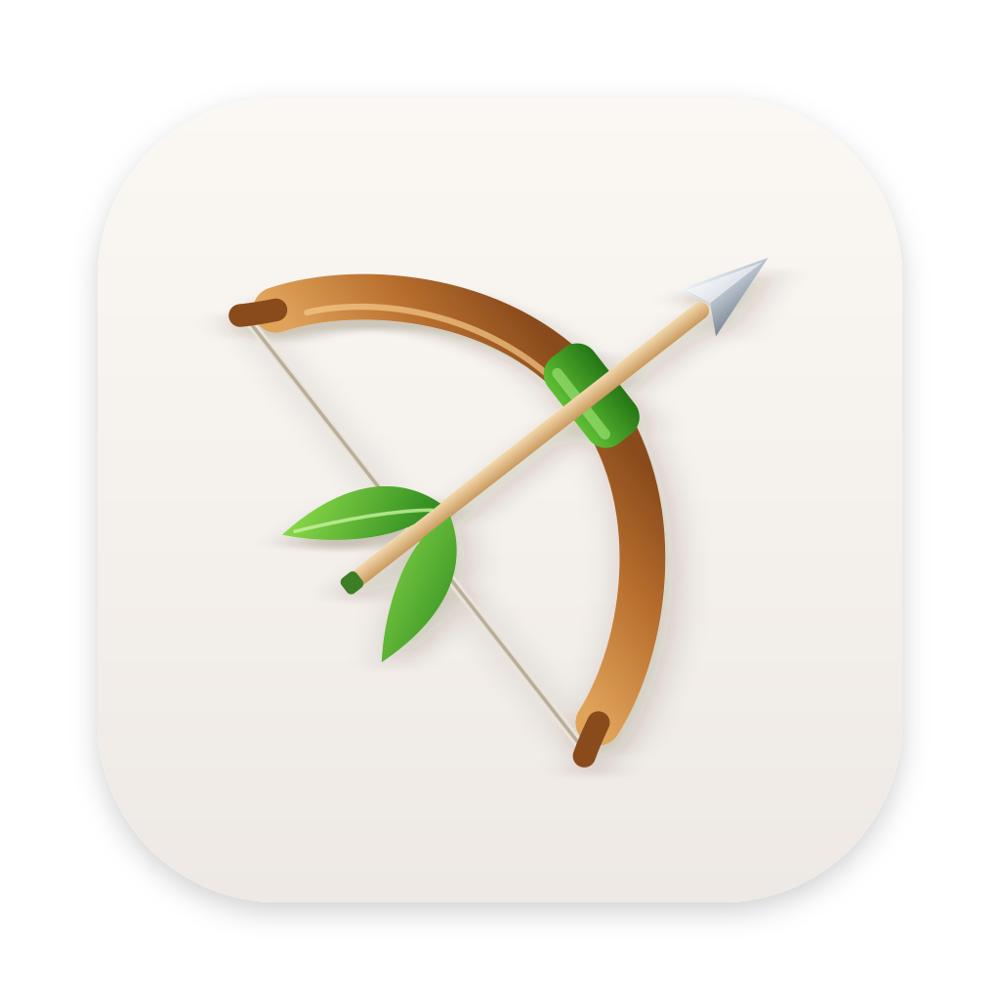

<p align="center"></p>

# Bowshot - (Experimental Work)

A local Mac game builder based on **nxnative**, with the Ocarina of Time work from **kid-with-sword-remake**. Choose your own game dump, build it on your Mac, and keep the result on your machine.

Bowshot packages other developers’ native-execution work with a small Mac launcher. It is not an independently developed replacement for nxnative. The game’s ARM code runs through nxnative’s runtime and Metal graphics layer rather than a conventional full-system emulator.

> [!IMPORTANT]
> The public source and the Bowshot launcher exclude commercial game dumps, console keys, extracted game programs, game assets, translated game shaders and personal saves. The few binary parser fixtures in the source are manufactured test headers, checked against pinned hashes.
>
> You supply your own lawfully obtained dump. A game app produced from that dump contains game material and is **not a shareable Bowshot release**. Keep that output private.

## Status

**Experimental preview.** This distribution is focused on the Switch 2 Ocarina of Time dump with update `v131072`. The engine is upstream nxnative's code as of 21 Nov 2026 (`seedds/nxnative` main `8c94bd1e`) plus Bowshot's additions and changes from kid-with-sword-remake, pinned as `bowshot-0.1.0-nxnative-8c94bd1e`; it does not silently track upstream updates. See [What's new](#whats-new).

It includes upstream's Ocarina of Time lighting, terrain and stability fixes, MetalFX for the game's own upscaler, a Render scale slider for the 3D size, and settings tuned to hold 60 FPS without overheating a fanless Mac. It is still a preview: results on other Macs, dumps and areas have not been certified.

## Download

No Bowshot release has been published yet: build the builder from source ([Building Bowshot](#building-bowshot)), or take the newest `Bowshot-<version>-macOS-arm64.zip` from this repository's [Releases](https://github.com/LeoGeneret/Bowshot/releases) once there is one, then follow [Setup and running](#setup-and-running). The download is the builder only: no game files are included.

## What's new

The first build converts every shader (the shader chain version changed).

- **Engine moved to upstream nxnative main `8c94bd1e`** (21 Nov 2026, about 635 more upstream commits). Among the latest: Ocarina of Time's foliage no longer crashes Apple's mesh compiler on macOS 26.6 (#3069), its shader map drops a false shader (#3010), shader library files are unmapped once loaded (less memory), and the audio thread gets a real-time deadline.
- **Upscaling:** MetalFX now draws Ocarina of Time's own upscaler networks through upstream's code (every NDSR pack, `_vr` packs included; about 1.4 ms less GPU a frame measured upstream on an M4 Pro with **Game's upscaler: MetalFX**), reads the game's texture in its own format, and takes the game's bias mask as its reactive mask.
- **Performance:** pipelines prewarmed in the Mac app, pipeline archives opened 3-6x faster, background pipeline lookups, unused border corrections compiled out of shaders, steadier frame pacing after a late frame, and a shader build that uses every core.
- **Area changes:** render targets that were drawn over are released a few at a time instead of all at once, which took a 120-250 ms frame once a second (kid-with-sword-remake L6.3).
- **Render scale slider** (launcher, Game → **Render scale**): the 3D size from 50 % to 100 % of 1920×1080 in twelfths, each step a whole 16:9 size, with **Potato** (960×540), **Normal** (1280×720, the default) and **Native** (1920×1080) marked on it. It replaces the earlier Normal / Potato presets and their game-file overlays. Ocarina of Time v131072 only (the render-scale stub from kid-with-sword-remake).
- **In game:** **⌥⌘P** shows or hides Apple's Metal HUD (frame-time graph included) without restarting; **⌘P** shows a performance panel (frames a second, frame and GPU time, the 3D size and its step: Potato, Normal, Native) and **⌘= / ⌘-** move the Render scale one step while you play; the step you leave is the next start's. All three are in the game window's **View** menu, and the settings window lists them under **While you play**.
- **Texture Memory Saver** (launcher, Performance, off by default): large compressed textures without their sharpest level, about a quarter less texture memory; slightly softer up close. On kid-with-sword-remake's Mac walk the longest frames went from 2.7 s / 0.5 s to 0.4 s / 0.3 s (kid-with-sword-remake L7).
- **Microphone** (launcher, Controls, off by default): play the ocarina into your Mac's microphone (upstream #1822).
- Kept: the GPU-hang watchdog, the dispatch and texel-fetch clamps.
- Removed as unused by default: the M1/M2 task isolation (`DM_NVN_ISOLATE_TASK`), damaged-file substitutes (`romfs_substitute`, `DM_ROMFS_SUBST`) and the SyncWait fence report.
- Removed, as upstream rewrote the code under them: the earlier chained-upscaler path, the remembered uniform-conflict answers and a per-draw shortcut (two small CPU savings).

## Features

- A Mac window for choosing your game folder, with a progress bar for each build step and the full build log one click away.
- A bundled, pinned engine source snapshot and its existing compiler tools; the launcher contains no playable game.
- Full local shader and pipeline preparation rather than a reduced first-area shader set.
- Ocarina's 3D size on any Render scale step between 50 % and 100 %: Normal (1280×720) by default, Potato (960×540) for the lightest.
- Private build outputs under `Bowshot-local/` in the chosen game folder.
- Separate writable engine and Python tools under `~/Library/Application Support/Bowshot/`; building does not modify the signed launcher.
- Content checks and Git ignore rules that keep private game outputs out of source packages.

## Setup and running

Follow these steps in order. Steps 1–3 are one-time setup. You need your own game file before step 4: Bowshot does not include, download or point to one.

### 1. Check your Mac

- An Apple silicon Mac (M1 or newer) with **at least 16 GB of memory**.
- **macOS 26.6 or later.** (The builder window opens on macOS 15+, but building and playing need 26.6.)
- **About 100 GB of free disk space** for your game file, the build, its caches and the finished game app.

### 2. Get Bowshot

1. From this project's [Releases](https://github.com/LeoGeneret/Bowshot/releases), download the newest `Bowshot-<version>-macOS-arm64.zip` (and `SHA256SUMS.txt` if you want to check the download with `shasum -a 256 -c SHA256SUMS.txt`).
2. Unzip it and move **Bowshot.app** to **Applications**.
3. The first time, **right-click the app → Open → Open**. Preview builds are not notarized, so a normal double-click is blocked once. If macOS still refuses, open **System Settings → Privacy & Security** and choose **Open Anyway**.

### 3. Install the tools (once)

1. Install **Xcode 27.2** from the App Store or Apple's developer site. Open it once and let it finish its first-time setup.
2. Install [Homebrew](https://brew.sh) if you don't have it.
3. Open **Terminal** and run:

```sh
brew install uv xcodegen zstd glslang
xcodebuild -downloadComponent MetalToolchain
```

To confirm everything is in place, run the builder's check (adjust the path if the app isn't in Applications):

```sh
bash /Applications/Bowshot.app/Contents/Resources/engine/scripts/bowshot_build.sh --doctor
```

It should end with `Prerequisite executables found.` Otherwise it names what is missing.


### 4. Prepare your game folder

1. Create a new, empty folder, for example `~/Games/Ocarina`.
2. Put **your own copy** of Ocarina of Time (Switch 2) in it, either as:
   - the game's single `.nup` file, **or**
   - the game's NSP file(s): the base game plus **update v131072**.

   This preview is built and tested only for update `v131072`.
3. Keep the folder **outside any Git repository** and outside the Bowshot source. The builder refuses those locations so that game files can't be published by accident. Avoid iCloud-synced folders: the build writes tens of gigabytes.

### 5. Build your game

1. Open **Bowshot** and click **Choose Game Folder…**. Select the folder from step 4 (the folder itself, not the file inside it).
2. Click **Build My Local Game**. The button turns blue once the folder is valid (outside any Git repository, with your `.nup`, NSP files or dump in it); otherwise the line under it says what is missing. A progress bar then shows the current step, its percentage and about how long is left; **Show build log** unfolds every message (blocking errors in red, warnings in orange).
   - The **first build takes 1.5 hours or more**: it translates and prepares every shader of the game on your Mac. Keep the Mac plugged in and awake. The window won't let you quit halfway.
   - The first run also installs a private Python into `~/Library/Application Support/Bowshot/`. It downloads Python packages only, never game files or keys.
3. When the status line says **"Local build ready"**, the log ends with `READY:` and the path of your game app.

Building again later reuses everything that is still valid, so it is much faster.

### 6. Play

1. Click **Open game folder**. It opens `Bowshot-local` inside your game folder.
2. Open **Ocarina of Time.app**. The first time, **right-click → Open**, as in step 3. If macOS asks whether the app may access a folder (for example Downloads or Documents), click **Allow**: the game needs it for its files and saves.
3. A settings window appears before the game starts. **Game → Render scale** sets the 3D size, on **Normal** (1280×720) by default, with **Potato** (960×540) and **Native** (1920×1080) marked on the slider; you can change it at every start, no rebuild needed. While playing, **⌘=** / **⌘-** change it one step at a time, **⌘P** shows or hides the performance panel and **⌥⌘P** Apple's Metal HUD (View menu; the settings window lists them under **While you play**). Then play with the **keyboard or a controller**. Xbox, PlayStation and most Bluetooth pads work.
4. **Quit** with **⌘Q**, or hold the controller's **Home** button for 2 seconds and press **A**. Progress the game hasn't saved is lost, so save in-game first.

Tips for smooth play:

- Play **in a window** and keep the game window **visible**. Don't cover it or drag it between screens while playing.
- Short stutters the **first time** you see a new area are normal: the game prepares those graphics once and remembers them.
- Close heavy apps and keep the Mac on power. Don't build and play at the same time.
- On an external display, a 120 Hz or 60 Hz refresh rate paces more evenly than 144 Hz in a window.

### Where things are

| What | Where |
|---|---|
| Your game app (private, contains your game) | `<game folder>/Bowshot-local/Ocarina of Time.app` |
| Build log (built from the window: one JSON event per line) | `<game folder>/Bowshot-local/build.log` |
| Settings chosen for your build | `<game folder>/Bowshot-local/runtime.env` |
| Game settings file (overrides) | `~/Library/Application Support/nxnative/0400486024DEC000/env.txt` |
| Game log (attach to bug reports) | `~/Library/Logs/nxnative/0400486024DEC000.log` |
| Builder's engine copy and Python | `~/Library/Application Support/Bowshot/` |

**Never upload `Ocarina of Time.app`, the `Bowshot-local` folder, your game file or your saves.** They contain game material.

### Troubleshooting

| Message or problem | What to do |
|---|---|
| `Missing prerequisite: …` or `uv is missing` | Redo step 2, then run the `--doctor` check. |
| `Install Xcode 27.2 and its Metal Toolchain` or a Metal compiler version error | Install exactly Xcode 27.2, open it once, run `xcodebuild -downloadComponent MetalToolchain`. Don't bypass the version check. |
| `Choose a game folder outside a Git repository` / `Keep game files outside the builder source` | Move your game folder somewhere else (step 4). |
| `The supported Ocarina of Time v131072 RomFS image was not found` | The folder doesn't contain update **v131072**. This preview supports only that update. |
| `Builder files are missing` | Download the full ZIP again from Releases and replace the app. |
| The app or game won't open ("cannot be opened" / "unidentified developer") | Right-click → **Open**, or **System Settings → Privacy & Security → Open Anyway**. |
| Black window | Keep the window visible and in front; don't switch to fullscreen. If it stays black, quit and reopen. |
| Low frame rate | In the game's settings window: **Game's upscaler** MetalFX and **Texture Memory Saver** on; close other apps, plug in power. On Apple GPUs a lower Render scale (Potato) saves little. |

Open an issue with your Mac model, macOS version, which Resolution you used, and the game log. Never attach game files, saves or keys.

## What belongs on GitHub

| Shareable project material | Keep private and outside the repository |
|---|---|
| This source snapshot and its original licence notices | NUP, NSP, NSZ, XCI, XCZ and extracted game modules |
| Bowshot’s game-free builder ZIP | Any locally generated game app (`Ocarina of Time.app`) or game IPA |
| Source ZIP, content-check report and SHA-256 checksums | RomFS images, game models, textures, audio and overlays |
| Build instructions and upstream acknowledgements | Translated game shader libraries, pipeline caches, saves and console keys |

Run the publication check before staging changes:

```sh
python3 tools/check_content.py --staged
```

Ignore rules do not remove files already committed to Git. This snapshot starts without upstream Git history; its origin and revision are preserved in `UPSTREAM-REVISION`, [CREDITS.md](CREDITS.md) and [AUTHORS.md](AUTHORS.md). Do not copy an existing game build or its old Git history into it.

## Known limitations

- This is a builder, not a prebuilt copy of Zelda. Each player builds from their own files.
- Performance and visual issues can still come from the underlying engine. There is no guarantee of 60 FPS or glitch-free lighting.
- A fresh machine needs the development tools above; this is not a self-contained replacement for Xcode. The .NET SDK is not needed: upstream ships the shader translator and extractor as native programs.
- The first local build is lengthy. Do not run a compiler-heavy build while judging gameplay performance.
- The 13 GiB Ocarina memory cap is a conservative local setting, not a guarantee against memory pressure in every area. The private `runtime.env` records the selected settings.
- Upstream gameplay screenshots are omitted from this publication snapshot. Some historical documentation still refers to that omitted gallery.
- The launcher is currently Apple silicon only. The underlying project’s iPhone and other workflows are not Bowshot release claims.

## Building Bowshot

This creates the **game-free launcher**, not a game:

```sh
python3 tools/check_content.py
python3 -m unittest discover -s tests -v
python3 tools/package_builder.py
```

The resulting `dist/` contains the launcher ZIP, a source ZIP, `SHA256SUMS.txt` and `CONTENT-CHECK.json`. `dist/` is ignored by Git; publish the checked ZIPs as release assets rather than committing the app bundle. No game dump is needed to package this launcher.

For a local game build without the launcher:

```sh
bash scripts/bowshot_build.sh --doctor
bash scripts/bowshot_build.sh --build /path/to/your/game-folder
```

## Credits

The original developers deserve the credit for the runtime, graphics and game support:

| People / project | Contribution |
|---|---|
| [seedds / nxnative](https://github.com/seedds/nxnative) | Base project, host/runtime, Metal integration, rewriter and continuing fixes. Original MIT copyright retained. |
| [Motion_Viz / GreenKid-MV](https://github.com/adi0900/GreenKid-MV) | The project Bowshot is forked from: the local-builder launcher, content checks and packaging, the Normal / Potato resolution presets and game-file overlays, the GPU-hang watchdog and the dispatch and texel-fetch clamps. |
| [cheemu21 / kid-with-sword-remake](https://github.com/cheemu21/kid-with-sword-remake) | The fork GreenKid-MV 0.1.0 was built on: Ocarina-specific integration, presets, upscaling work and documented Mac/iPhone experiments. Its Ocarina features are carried forward onto upstream main in 0.2.0. |
| Xipzer | Performance work credited in the imported history and fork documentation. |
| Pedro Nascimento | Imported graphics-scale work and other contributions, as recorded in the upstream history. |
| [All recorded upstream contributors](AUTHORS.md) | The complete author list from the pinned source snapshot, with example commit links. |
| [jhaizhou-ops / d2r-mobile](https://github.com/jhaizhou-ops/d2r-mobile) | The native-execution foundation acknowledged by nxnative. |
| Ryujinx, LibHac, SPIRV-Cross, Atmosphère, MacNativeGames and the other dependency authors | Translation, extraction, system references and supporting libraries. See [THIRD_PARTY_NOTICES.md](THIRD_PARTY_NOTICES.md). |

Bowshot, like GreenKid-MV before it, adds the distribution boundary, local-builder launcher and packaging checks. It does not claim authorship of the imported engine fixes. The straightforward README organization was inspired by [NX2navi](https://github.com/tangerineturtle1/NX2navi); none of that project’s code, artwork or restricted additions were imported.

## Licence and project identity

The imported engine retains its [MIT licence](LICENSE). Third-party components retain their own terms and notices. The original upstream overview is retained in [UPSTREAM_README.md](UPSTREAM_README.md).

No software licence grants rights to Nintendo’s game content. Removing game data from a release is a technical distribution boundary, not legal clearance. Bowshot is an independent project and is not affiliated with or endorsed by Nintendo. Game and platform names belong to their respective owners.
